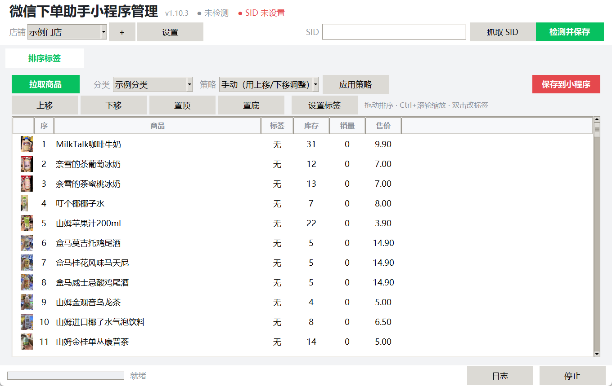

# 微信下单助手小程序管理

一个 Windows 桌面工具，用来管理微信「下单助手 / 经营账本 / 经营码店员助手」里的商品排序和标签。

**只做小程序管理，不含惠管家库存同步。**



## 功能

- **SID 抓取**：自动识别店主（`auth_type=3`）和店员（`auth_type=4`）SID，抓到即复制到剪贴板；
- **多店铺**：一个微信保存多家门店，各自保存 SID、`mch_id`、`shop_id`；
- **SID 状态**：顶部常驻显示，启动 / 切换店铺 / 每 2 分钟自动探测，失效变红；
- **商品排序**：拖动、上移下移、置顶置底，或按名称/库存/销量/价格/条码一键重排；
- **标签**：无 / 招牌 / 新品 / 热销，支持多选批量设置；
- **图片预览**：缩略图 + `Ctrl + 滚轮` 缩放行高与图片；
- **安全**：保存前自动备份，排序按分类整单提交。

## 快速开始

1. 安装：运行 `微信下单助手小程序管理_安装包_v1.0.0.exe`，或解压便携版；
2. 打开后点右上角 **「抓取 SID」**；
3. 电脑微信打开「经营账本 → 商品管理」或「经营码店员助手 → 商品页」刷新；
4. 抓到后命名店铺；
5. 切到「排序标签」→ **「拉取商品」** → 拖动排序 / 设置标签 → **「保存到小程序」**。

详细步骤见 [使用手册](docs/使用手册.md)，典型用法见 [使用场景](docs/使用场景.md)。

## 文档

- [使用手册](docs/使用手册.md)：安装、抓 SID、店铺、拉取、排序、标签、缩放、排错
- [使用场景](docs/使用场景.md)：多店管理、只改排序不动库存、新品标签、活动置顶、店员代管、新店初始化

## 运行环境

- Windows 10/11（x64）
- 安装版自带 Python 运行时，无需配置
- 源码运行需要 Python 3.10+、Tkinter、Pillow

## SID 抓取组件

抓包依赖 `tools\sid\SID抓取后端.exe`（约 31MB，未提交到仓库，请自备）：

```
tools\sid\SID抓取后端.exe
tools\sid\sid_addon.py
tools\sid\mitmproxy-ca-cert.pem
```

程序会以 `--mitm -s sid_addon.py` 方式调用它，从请求的 query/body/header/cookie 中提取 SID 与 `mch_id/shop_id`。

## 打包

```bat
:: 便携版
xcopy /E /I src dist\app
xcopy /E /I tools dist\app\tools
xcopy /E /I runtime dist\app\runtime

:: 安装包（需要 .NET Framework csc）
csc /define:SHOP /target:winexe /resource:payload.zip,payload.zip ^
    /resource:uninstaller_shop.exe,uninstall.exe installer.cs
```

## 注意

- 排序会**覆盖该分类在小程序里的顺序**，保存前自动备份到 `data\backup`；
- 本工具不修改库存、价格，也不写惠管家；
- SID 会过期，状态变红时重新抓取即可；
- 请遵守微信平台规则，仅管理自己有权管理的门店。

## License

[MIT](LICENSE)
